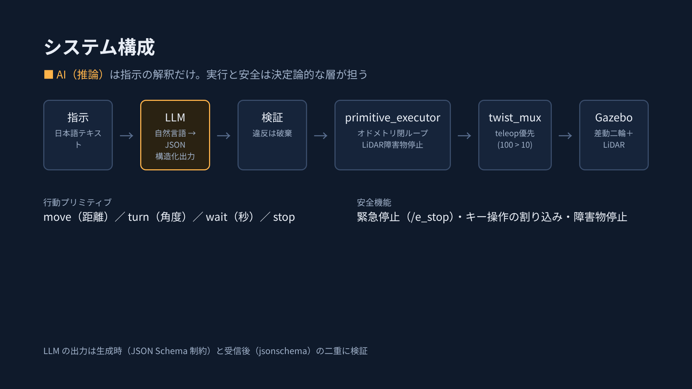

# 自然言語で動く差動二輪ロボット（PAI最終課題＿41473）

日本語の指示をローカルLLMが**行動プリミティブ（JSON）**に変換し、オドメトリによる閉ループ制御で安全に実行する差動二輪ロボットのシミュレーションです。
Physical AI 応用1講座（2026 Summer）の最終課題として作成しました。



**AIが担う範囲**：LLM が行うのは「自然言語 → 行動プリミティブ」の変換（推論）だけです。スキーマ検証、速度指令の生成、障害物停止、緊急停止は、すべて決定論的な処理です。

## 主な特徴

- **行動プリミティブ**：`move`（距離）、`turn`（角度）、`wait`（秒）、`stop` の4種類。LLM には速度指令を直接生成させない
- **二重のスキーマ検証**：生成時に JSON Schema で出力を制約（LM Studio の構造化出力）し、受信後に `jsonschema` で再検証。違反・推論失敗のときはロボットを動かさない
- **閉ループ制御**：オドメトリで進行距離と累積回転角を測り、目標で停止。正方形走行（1辺1 m）の終端誤差は平均 0.50 cm（開ループは 66.8 cm）
- **安全設計**：キー操作が自動走行より常に優先（twist_mux）、`/e_stop` による緊急停止、LiDAR による前方障害物での停止、待機中もゼロ速度を出し続ける
- **比較評価**：正規表現版（rule）との変換成功率の比較、ホールドアウト指示での評価

## 動作環境

| 項目 | バージョン |
| --- | --- |
| OS | Ubuntu 24.04（WSL2、Windows 11） |
| ROS 2 | Jazzy Jalisco |
| シミュレータ | Gazebo Harmonic（`ros-jazzy-ros-gz`） |
| LLM | google/gemma-4-12b-qat（Q4_0）、LM Studio の OpenAI 互換 API、思考の出力はオフ |
| GPU | NVIDIA GeForce RTX 5060 Ti（16 GB） |

## パッケージ構成

```text
.
├── scripts/
│   ├── gen_robot_sdf.py       ロボットSDFの生成（慣性を形状と質量から自動計算）
│   ├── eval_parsers.py        指示セットの変換評価（rule / llm）
│   ├── eval_cases.json        評価用の指示12件
│   ├── eval_cases_holdout.json  ホールドアウトの指示5件
│   ├── plans/                 手書きの行動列（LLMなしの検証用）
│   ├── send_plan.sh           行動列を /primitives に送る
│   ├── say.sh                 指示を /instruction に送る
│   └── run_case.sh            指示の送信と前後の位置測定
└── src/
    ├── pai_description/       ロボットモデル（pai_bot）とワールド（arena）
    ├── pai_bringup/           launch、ブリッジ・twist_mux・GUIの設定
    ├── pai_control/           primitive_executor（閉ループ実行・安全機能）
    └── pai_commander/         llm_commander、rule_parser、JSON Schema、プロンプト
```

## セットアップ

```bash
# ROS 2 Jazzy を導入済みの Ubuntu 24.04 で
sudo apt install -y ros-jazzy-ros-gz ros-jazzy-teleop-twist-keyboard ros-jazzy-twist-mux \
  python3-jsonschema python3-venv
git clone <このリポジトリのURL> ~/pai_ws
cd ~/pai_ws
python3 -m venv --system-site-packages ~/pai_venv
~/pai_venv/bin/pip install openai
source ~/pai_venv/bin/activate
source /opt/ros/jazzy/setup.bash
python -m colcon build --symlink-install     # venv の Python でビルドする
source install/setup.bash
cp .env.example .env                         # LLM_BASE_URL と LLM_MODEL を記入
```

LM Studio では 7B 以上の指示追従モデルを読み込み、サーバーを起動します（既定ポート 1234）。思考（推論過程）を出力するモデルは、その出力をオフにしてください（応答時間が約1/8になります）。

## 実行

```bash
# 端末1：一括起動（Gazebo、ブリッジ、twist_mux、executor、commander）
set -a && source .env && set +a
ros2 launch pai_bringup sim.launch.py parser:=llm     # 正規表現版は parser:=rule

# 端末2：指示を送る
scripts/say.sh "1辺1mの正方形を左回りで描いて"
ros2 topic echo /executor/status

# 端末3（任意）：キー操作。自動走行より優先される
ros2 run teleop_twist_keyboard teleop_twist_keyboard --ros-args \
  -r cmd_vel:=cmd_vel_teleop -p speed:=0.3 -p turn:=0.8

# 緊急停止と解除
ros2 topic pub --once /e_stop std_msgs/msg/Bool "{data: true}"
ros2 topic pub --once /e_stop std_msgs/msg/Bool "{data: false}"
```

変換の記録は `logs/commander.jsonl` に1指示1行で保存されます。

## 評価の再実行

```bash
set -a && source .env && set +a
~/pai_venv/bin/python scripts/eval_parsers.py                          # 指示12件
~/pai_venv/bin/python scripts/eval_parsers.py eval_cases_holdout.json  # ホールドアウト5件
```

## 主な結果

| 評価 | rule | LLM |
| --- | --- | --- |
| 指示12件の変換成功率 | 4/12（33%） | 36/36（100%、各3回試行） |
| うち定型以外の8件 | 0/8 | 24/24 |
| ホールドアウト5件 | 3/5 | 12/15（80%） |

| 正方形走行（1辺1 m、3回平均、真値） | 位置の誤差 | 向きの誤差 |
| --- | --- | --- |
| 閉ループ（本実装） | 0.50 cm | −0.31° |
| 開ループ（速度×時間） | 66.8 cm | −49.3° |

詳細は提出したレポート（説明資料）を参照してください。

## 参考

- 構成の参考：[gazeboとROS2を連携してロボットを操作する（Qiita）](https://qiita.com/N622/items/9d89f77d85d9da0af29e)（講座の最終課題サンプル、ROS 2 Humble + Ignition Fortress）
- 本リポジトリでは、ロボットモデル、ワールド、コードをすべて独自に作成し、ROS 2 Jazzy + Gazebo Harmonic で実装しました。記事からの主な差分は、LLM による指示の解釈、行動プリミティブ層と二重のスキーマ検証、オドメトリによる閉ループ制御、安全設計（優先度制御・緊急停止・障害物停止）、定量評価です。

## ライセンス

Apache License 2.0（[LICENSE](LICENSE)）
